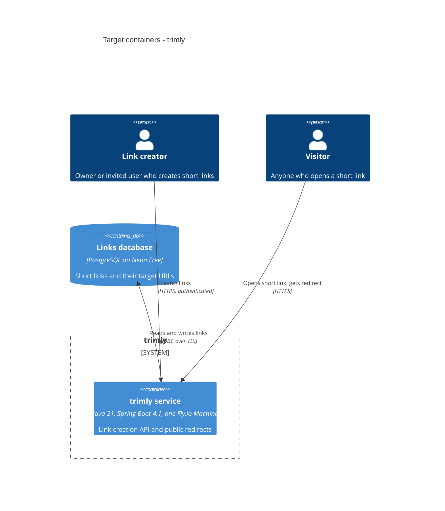

# Architecture map — trimly

> **Greenfield foundation (target baseline).** No code exists yet. This map records the foundation chosen
> with the owner on 2026-11-01. `scaffold` builds it from `docs/features/_scaffold/tasks.json`, and
> specify / design / data-model / implement follow it. Once code exists, re-run `survey` so the map
> describes the code as it actually is.

## Stack

- Language / runtime: Java 21 (LTS). Chosen because the owner reviews Java most fluently (survey, 2026-11-01), and the local JDK is Amazon Corretto 21.0.8 (`java -version`).
- Frameworks: Spring Boot 4.1.x. Spring Initializr's default on 2026-11-01 was 4.1.2; the exact version is pinned at scaffold. Chosen for its documentation, how well coding agents know it, and its relevance to the learning and portfolio goals (owner decision). Tradeoff: it has the highest idle memory of the candidates, which matters for machine sizing (see §Constraints).
- Build tool: Maven, through the committed Maven Wrapper (`./mvnw`), so no global install is needed. Chosen because its single standard way of doing things makes agent-written build changes easy to review (owner decision).
- Build / test / lint: build `./mvnw -B package`; unit tests `./mvnw -B test`; unit + integration tests `./mvnw -B verify`; formatting check `./mvnw -B spotless:check`. Format code with `./mvnw spotless:apply`.
- Decisions: [ADR-0001](adr/0001-use-java-21-spring-boot-and-maven.md).

## C4 — system as it is

Target baseline. Nothing is built yet (greenfield); this is what scaffold and the first features build towards.

## Module inventory

| Module | Path | Layers | Wired at | Responsibility |
|---|---|---|---|---|
| link | `src/main/java/io/github/igorermolenko/trimly/link/` | api / app / domain / infra | Spring component scan of the module package (scaffold) | Write path: create short links and generate codes; offers a lookup the redirect module uses |
| redirect | `src/main/java/io/github/igorermolenko/trimly/redirect/` | api / app | Spring component scan (scaffold) | Read path: resolve a code and send the HTTP redirect; depends only on `link`'s published API |
| access | `src/main/java/io/github/igorermolenko/trimly/access/` | api / app / domain | Spring component scan; `@ConfigurationProperties` scan for the owner credential | Owner authentication: a stateless Spring Security filter chain guards the owner API (`/api/**`) with the owner credential as a bearer token; redirects stay public ([url-shortener ADR-0001](features/url-shortener/adr/0001-guard-owner-operations-with-spring-security-in-an-access-module.md)) |
| shared | `src/main/java/io/github/igorermolenko/trimly/shared/` | — | — | Cross-cutting pieces only: error envelope, ID generation, clock. No business logic |

Each layer has one job. `api` holds HTTP controllers and DTOs. `app` holds use cases and transactions. `domain` holds plain Java with no Spring or database imports. `infra` holds persistence and outside adapters. Modules talk only through each other's published `api`/`app` types, and an automated boundary test enforces this (§Conventions). Access control for invited users is a feature decision, made by `specify`/`design`, not part of the foundation. `io/github/igorermolenko/trimly` is the root package defined in §Conventions.

## Conventions (cited — the rules a new feature must match)

There's no code yet, so each rule cites the ADR or brief section that decided it, plus the file that scaffold creates to put it in place (marked *scaffold Sn*).

- **Root package:** `io.github.igorermolenko.trimly`, with the application class `TrimlyApplication` at the root (*scaffold S1*).
- **Module wiring / registration:** each top-level package under the root is a module, found by Spring's component scan. Layers inside a module are `api` / `app` / `domain` / `infra`. `domain` has no Spring or persistence imports. Modules use only each other's published `api`/`app` types. Enforced by a Spring Modulith `ApplicationModules.of(TrimlyApplication.class).verify()` test, `src/test/java/io/github/igorermolenko/trimly/ModularityTest.java` (*scaffold S2*). Decision: [ADR-0002](adr/0002-organize-code-as-feature-modules-with-layers.md).
- **Error handling:** every error response uses RFC 9457 Problem Details (Spring's built-in `ProblemDetail`), produced by one `@RestControllerAdvice` in `shared` (*scaffold S1*). Sanctioned exception: `access`'s authentication entry point answers "authentication required" before any controller runs, handing the same `ProblemDetail` shape to the MVC exception resolvers. Error responses never expose stack traces.
- **IDs:** primary keys are UUIDv7 values generated by the app through one `shared` ID generator. Public short codes are a separate field, designed per feature. Decision: [ADR-0003](adr/0003-store-links-in-postgres-on-neon-via-spring-data-jdbc-and-flyway.md).
- **Persistence / DB access:** Spring Data JDBC repositories live only in a module's `infra` layer; there is no JPA/Hibernate. Connection settings come only from env vars (`SPRING_DATASOURCE_URL`, `SPRING_DATASOURCE_USERNAME`, `SPRING_DATASOURCE_PASSWORD`). [ADR-0003](adr/0003-store-links-in-postgres-on-neon-via-spring-data-jdbc-and-flyway.md).
- **Migrations:** Flyway, plain SQL, forward-only, in `src/main/resources/db/migration/V<n>__<snake_case_description>.sql`, applied when the app starts (*scaffold S3*). [ADR-0003](adr/0003-store-links-in-postgres-on-neon-via-spring-data-jdbc-and-flyway.md).
- **Tests:** JUnit 5 + AssertJ.
  - Unit tests are `*Test`, run by Surefire through `./mvnw -B test`.
  - Integration tests are `*IT`, run by Failsafe through `./mvnw -B verify`, against a throwaway PostgreSQL container started by Testcontainers (needs Docker). They never touch Neon.
  - Tests mirror the main package layout (*scaffold S2*).
- **Formatting / lint:** Spotless with google-java-format; CI fails on `./mvnw -B spotless:check` (*scaffold S2*).
- **CI:** one GitHub Actions workflow, `.github/workflows/ci.yml`, runs `./mvnw -B verify` and `spotless:check` on every push and pull request, on JDK 21 (*scaffold S4*). Deploying to Fly.io is a separate roadmap step, not part of the foundation.
- **Config / secrets:** secrets come only from env vars and are never committed. `application.yml` holds non-secret defaults only. Production must also set `TRIMLY_OWNER_CREDENTIAL`, `TRIMLY_PUBLIC_BASE_URL` (http(s), host and optional port only) and `TRIMLY_OWN_HOSTS` (bare host names); trimly refuses to start without them.
- **Inter-module communication:** direct method calls to another module's published `app` type. No events or HTTP between modules unless a later design adds them.
- **UI / styling:** none; the service is backend-only (see §Frontend).

## Datastores

| Store | Engine | Accessed via | Notes |
|---|---|---|---|
| Links database | PostgreSQL on Neon Free plan | Data-access library per §Conventions, connection from env vars | $0, permanent; 1 GB storage, 100 CU-hours/month per project; compute pauses after 5 minutes idle and wakes in "a few hundred milliseconds" (https://neon.com/pricing, checked 2026-11-01). Place it in the same region as the app. Integration tests run against a throwaway Postgres container, never Neon |

## Frontend / UI foundation

<!-- N/A: no frontend -->

Backend only. Link creation is an authenticated HTTP API, and visitors only receive redirects. If a later roadmap step adds a web UI, re-run `survey` to set up its foundation.

## Where things live / closest precedents

There are no precedents yet. The first feature (the core shortener) becomes the model for later ones.

- New capability in an existing area (for example, custom aliases are part of link creation) → extend that module, such as `src/main/java/io/github/igorermolenko/trimly/link/`.
- New, separate capability (for example, click analytics) → a new module package under the root with its own `api` / `app` / `domain` / `infra`.
- New schema change → the next `V<n>__...sql` in `src/main/resources/db/migration/`.
- New cross-cutting helper → `shared`, only if at least two modules need it and it has no business logic.

## Constraints & known tech-debt

- **Budget about $5/month** (`docs/idea-brief.md` §5). The app runs on one always-on 512 MB `shared-cpu-1x` Fly.io Machine ($3.69/month) and the database on Neon Free ($0). Both prices were checked on 2026-11-01 (https://docs.fly.io/about/pricing, https://neon.com/pricing). Anything that adds always-on infrastructure (a second machine, a managed Redis, etc.) needs a budget decision first.
- **Spring Boot memory on 512 MB** (assumption). Not measured yet; check during scaffold or the first deployment, and tune JVM memory flags if needed.
- **Neon pauses after 5 minutes idle.** The first query after that waits a few hundred milliseconds, which works against "instant redirects" after idle periods. A design for the redirect path may add a cache.
- **Only the owner and invited users can create links; redirects are public** (`docs/idea-brief.md` §5). Abuse handling for anonymous users is out of scope.
- **No AI or LLM features in the product** (`docs/idea-brief.md` §5).
- **Integration tests need Docker** (Testcontainers). Docker 28.4.0 is installed locally; GitHub-hosted Ubuntu runners include Docker.

## Reconciliation with the authored architecture doc

There is no authored architecture doc (no `docs/architecture.md`, `ARCHITECTURE.md` or root `CLAUDE.md`), so this map is the current reference. Its intent comes from `docs/idea-brief.md`, which `interview` produced.
