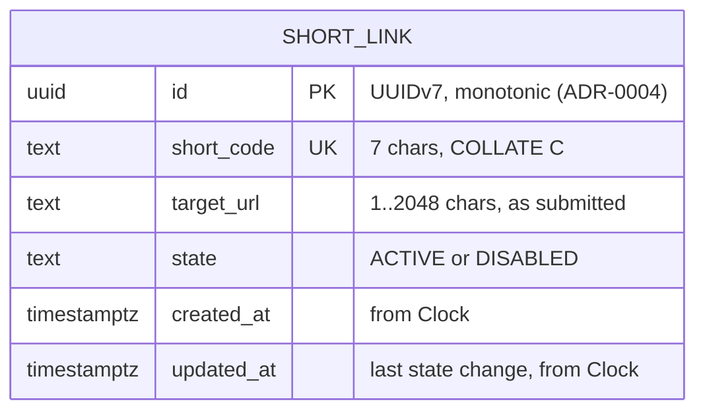

# Data model — url-shortener

> **Inputs:** [spec.md](spec.md) §5, [sad.md](sad.md) §5/§6/§8, feature ADR-0002/0004, repo [ADR-0003](../../adr/0003-store-links-in-postgres-on-neon-via-spring-data-jdbc-and-flyway.md).
> **Staged migrations:** [`migrations/01_create_short_link.up.sql`](migrations/01_create_short_link.up.sql) (+ `.down.sql`). These are not yet in `src/main/resources/db/migration/`; `implement` promotes them.

## Aggregates

One aggregate, **ShortLink**, which is its own root and is owned by the `link` module. It has no child entities: a short link is a single row holding its id, short code, target URL, state and time columns. Only `link.infra` touches the table (sad.md §5). `redirect` reaches it only through `link.app.LinkLookup`. There is no owner or user entity in this step: one owner credential and no per-link ownership (sad.md §8 Authorization). Invited users arrive in roadmap step 4, and that step will add an owner reference as an expand migration.

## ER diagram

## Entities

### `short_link`

| Column | Type | Constraints | Notes |
|---|---|---|---|
| `id` | `UUID` | PK (`pk_short_link`) | Generated by the app with `shared.IdGenerator`: UUIDv7, monotonic within a millisecond (ADR-0004). Never shown publicly. |
| `short_code` | `TEXT COLLATE "C"` | NOT NULL, UNIQUE (`uq_short_link_short_code`), CHECK length = 7 | The public code. The 56-character alphabet is defined only in `link.domain` (sad.md §4.2), so SQL checks only the length. `"C"` collation keeps equality byte-wise and case-sensitive whatever the database locale is (AC-01: letter case matters). |
| `target_url` | `TEXT` | NOT NULL, CHECK `char_length` 1..2048 | Stored exactly as submitted (AC-01, AC-05). The 2048 limit mirrors AC-04. All other URL rules (scheme, encoding, own hosts) live in `link.domain`. |
| `state` | `TEXT` | NOT NULL, CHECK in (`ACTIVE`, `DISABLED`) | Maps 1:1 to the `LinkState` enum. Set to `ACTIVE` on create. |
| `created_at` | `TIMESTAMPTZ` | NOT NULL | Set by the app from the same `Clock` instant as the id (sad.md §8 ID strategy). No DB default. |
| `updated_at` | `TIMESTAMPTZ` | NOT NULL | When the state last actually changed. Equal to `created_at` on insert, set by the app from `Clock`, no DB default. A repeated disable or re-enable leaves it unchanged (AC-14). |

**Aggregate root:** root (`ShortLink`).

**Lifecycle:** insert once, then update only `state` and `updated_at`. `short_code`, `target_url` and `created_at` never change (AC-20, spec §3). Rows are never deleted, so the unique constraint keeps a code from ever being reissued (ADR-0002).

**Access patterns** (each one SQL statement, 2 s budget, ADR-0003):

| Pattern | Statement shape | Served by |
|---|---|---|
| Create (AC-01, AC-02, AC-20b) | `INSERT INTO short_link (id, short_code, target_url, state, created_at, updated_at) VALUES (…, 'ACTIVE', :now, :now)`. On a violation of `uq_short_link_short_code` (matched by constraint name), regenerate the code and retry, up to 5 attempts, each its own statement | `uq_short_link_short_code` (enforces) |
| Follow (AC-07, AC-12, AC-16, AC-17) | `SELECT target_url, state FROM short_link WHERE short_code = :code` (a disabled link maps to `NotFound` in `link.app`) | `uq_short_link_short_code` |
| List page (AC-09, AC-10) | `SELECT … FROM short_link [WHERE id < :cursor] ORDER BY id DESC LIMIT :size + 1` (the extra row tells whether more follow) | `pk_short_link` (backward scan) |
| Disable / re-enable (AC-11, AC-13, AC-14, AC-15) | `UPDATE short_link SET updated_at = CASE WHEN state <> :state THEN :now ELSE updated_at END, state = :state WHERE short_code = :code RETURNING short_code, state`. No row returned → "link not found" (AC-13). A repeat matches the row but changes nothing, so it confirms the current state (AC-14) | `uq_short_link_short_code` |

**Constraints:** PK on `id`; UNIQUE on `short_code`; CHECKs on the `short_code` length, the `target_url` length and the `state` values. These CHECKs back up the domain rules; they don't replace them. The domain validates first, so a CHECK violation means a bug, not a user error. There are no foreign keys (single table).

## Indexes

| Index | Columns | Query it serves |
|---|---|---|
| `pk_short_link` (implicit, from the PK) | `id` | List page: `WHERE id < :cursor ORDER BY id DESC LIMIT n`, read by a backward scan of the PK index (sad.md §6 "List short links", ADR-0004). |
| `uq_short_link_short_code` (implicit, from UNIQUE) | `short_code` | Follow a short link by code (§6 critical flow 1); disable or re-enable by code (§6 "Disable or re-enable"); collision detection on create insert-retry (§6 critical flow 2, ADR-0002). |

No other indexes. Every query is either by `short_code` or by `id` order. No query filters by `state` or `created_at`, so neither gets an index.

## Seeds

None. The table starts empty (AC-10). The uptime probe's known active short link (ADR-0006) is created by the owner through the API after deploy, not seeded, because its code is random.

## Test fixtures

The repo has no fixture pattern yet. Following the "tests mirror the main package layout" convention (CLAUDE.md), `implement` creates:

- `src/test/java/io/github/igorermolenko/trimly/link/ShortLinkFixtures.java`: a test data builder.
  - `aShortLink()`: an active link. The short code comes from the real `ShortCodeGenerator` with a seeded `Random` (deterministic), the target URL is `https://example.test/articles/1`, and the times come from a fixed `Clock`.
  - `.disabled()`, `.withShortCode(String)`, `.withTargetUrl(String)`, `.createdAt(Instant)`: modifiers.
  - Integration tests (`*IT`, Testcontainers) persist built links through the real repository, never by raw SQL, so the row mapping is exercised.
- **PII guard:** target URLs use only `example.test` hosts (`https://example.test/…`, `https://sub.example.test/…`). No names, emails or real domains.
