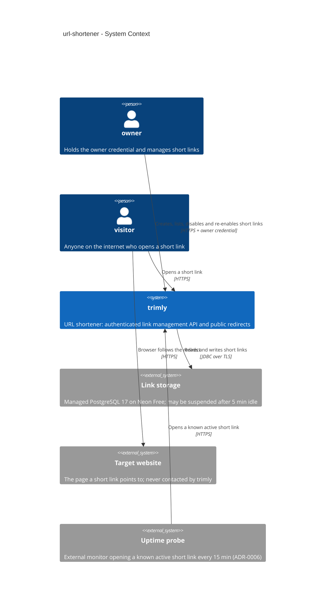
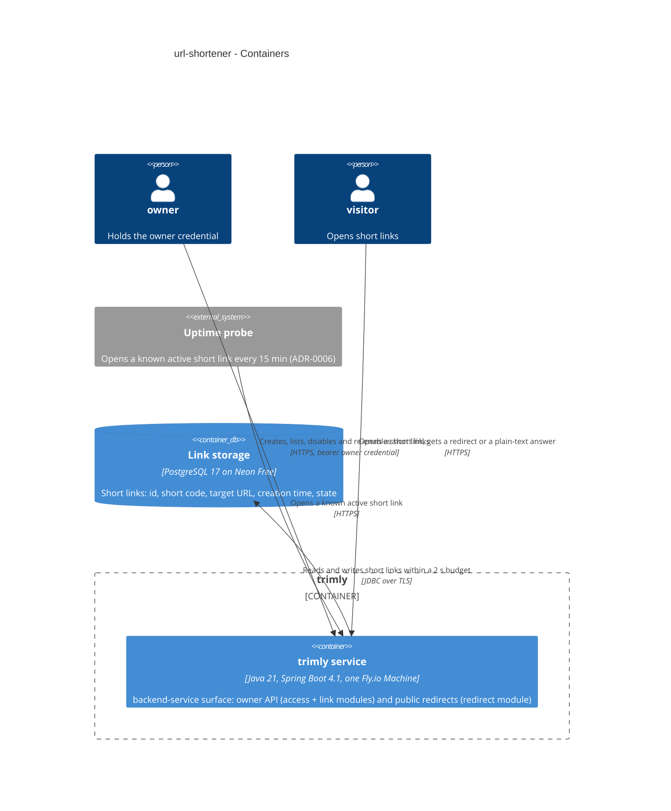

# Software Architecture Document — url-shortener

<!-- 12 Arc42 sections. Empty section → <!-- N/A: <one-line reason> -->. -->
<!-- C4 Context (L1) lives inline in §3. C4 Container (L2) lives inline in §5. -->
<!-- Numbers in §10 come VERBATIM from spec.md §6 NFR — no inventing, no rounding. -->

## 1. Introduction and goals

<!-- 🎯 Why: durable memory of «what + the three dominant qualities + who cares». A year from
     now nobody recalls which three qualities were critical for this system.
     📋 Write: 1 ¶ intent + 3 lines of top-3 quality goals + a stakeholders table.
     ¶4 is the override slot — critic `Override` resolutions emit «Decision override: <headline>
     — rationale: <reason>» bullets here so downstream skills see the deliberate choice. -->

**Intent.** The owner turns any http/https target URL into a short link: a freshly generated 7-character short code that is easy to type by hand. Any visitor who opens the short link goes straight to the target URL. The owner can list their short links and disable or re-enable any one of them, and a disable takes effect for every visitor at once. This is roadmap step 2 and the first feature built on the skeleton, so its shape (modules, auth boundary, error handling, tests) is the pattern later steps follow (spec §1, §2).

**Top-3 quality goals (1-liners; full scenarios in §10):**

1. **Honest, available redirects.** Redirects are available 99.5 % of a month. When link storage is down, a visitor sees "temporarily unavailable" within 2 s and never "link not found" (spec §6, AC-16, AC-17).
2. **Fast redirects within budget.** Redirect p95 is ≤ 50 ms with link storage awake and ≤ 1 s for the first request after idle, on infrastructure costing ≤ $5 per month (spec §6).
3. **Owner control.** Only the owner credential can create, list, disable or re-enable short links, and a disable reaches the very next visit (0 s propagation) (spec §6, §6.1, AC-12, AC-18).

The order settles conflicts. A choice that speeds up redirects (goal 2) at the cost of honest outage answers or instant disables (goals 1, 3) loses.

**Stakeholders.**

| Role | Interest | Sign-off owner? |
|---|---|---|
| owner | Creates short links and manages them (list, disable, re-enable) through the authenticated API | No |
| visitor | Opens short links and is redirected, with no credential | No |
| Tech Lead | SAD approval (igorermolenko) | Yes |
| Security Lead | Reviews trimly's first authentication boundary and the public redirect surface (spec §6.1 "Security review: Required") | No |

<!-- Decision overrides (¶4) — populated by the critic resolution loop, empty otherwise. -->

**Decision overrides.**
- Decision override: uptime probe every 15 min instead of every 5 min (spec §6 availability measurement). Rationale: a 5-minute probe keeps Neon compute permanently awake (≈ 182 CU-hours against the 100 CU-hour Free allowance), which would suspend link storage around day 17 of every month. See [ADR-0006](adr/0006-let-link-storage-scale-to-zero-with-a-draining-pool-db-free-health-checks-and-a-15-minute-probe.md). Spec sync is tracked in §11.

## 2. Constraints

<!-- 🎯 Why: §4 strategy only works when §2 has fixed WHAT IS ALREADY FIXED — stack, versions,
     deadline, regulatory. This is an input, not an output.
     📋 Write: four blocks — Technical / Organisational / Conventions / Regulatory.
     📌 Pin versions («<datastore> 18», not «<datastore>»); «Q3 deadline — hard», not «ideally».
     Never N/A — every feature inherits at least Conventions + Technical. -->

**Technical.**
- Java 21 (Amazon Corretto 21), Spring Boot 4.1.2, Spring Modulith 2.1.1, Maven through the committed wrapper (`./mvnw`). See [ADR-0001](../../adr/0001-use-java-21-spring-boot-and-maven.md) and `pom.xml`.
- PostgreSQL 17. Integration tests run `postgres:17-alpine` (`TestcontainersConfiguration`), so the Neon project must be created on PostgreSQL 17 to match. Access goes only through Spring Data JDBC; there is no JPA. Migrations are Flyway plain SQL, forward-only, applied on startup. See [ADR-0003](../../adr/0003-store-links-in-postgres-on-neon-via-spring-data-jdbc-and-flyway.md).
- Production runs **one** always-on 512 MB `shared-cpu-1x` Fly.io Machine ($3.69/month) against Neon Free ($0). There is never a second instance in this step (`docs/architecture-map.md` §Constraints).
- **Neon Free compute allowance:** 100 CU-hours per month per project. At 0.25 CU that is about 400 hours of awake compute, against about 730 hours in a month. Compute suspends after 5 minutes idle, and Free cannot turn that off. When the allowance is used up, compute stays suspended until the next monthly window, which is a hard outage. The figures come from neon.com docs, checked 2026-11-02. The 0.25 CU minimum size is inferred from Neon's "≈ 400 h at 0.25 CU" wording; verify it at the deploy step.
- Architecture: feature modules `link` (write path), `redirect` (read path) and `shared` (cross-cutting only), with `api` / `app` / `domain` / `infra` layers. `domain` has no Spring or persistence imports. Modules call only each other's published `api`/`app` types, through direct method calls. `ModularityTest` (Spring Modulith `verify()`) fails the build on any violation. See [ADR-0002](../../adr/0002-organize-code-as-feature-modules-with-layers.md).
- **No redirect caching.** AC-17 says trimly "does not serve the redirect from any remembered copy of the link", and spec §6 requires a disable to reach the next visit in 0 s. Every redirect is therefore resolved against link storage. This is a spec constraint, not a design choice.

**Organisational.**
- One person, the owner (igorermolenko), builds and runs trimly. It is a learning and portfolio project with no deadline (spec §1, `docs/idea-brief.md` §4).
- Budget: ≤ $5 per month for everything needed to serve trimly (spec §6). Anything that adds always-on infrastructure needs a budget decision first.
- The work goes through the full spec → design → tasks → TDD trail, and this feature is the pattern for later roadmap steps (spec §2).

**Conventions.**
- [`CLAUDE.md`](../../../CLAUDE.md) and [`docs/architecture-map.md`](../../architecture-map.md) §Conventions.
- Primary keys are UUIDv7 from `shared.IdGenerator`. The public short code is a separate field. Time comes only from the injected `java.time.Clock` (`shared.ClockConfiguration`).
- Errors use RFC 9457 Problem Details through the single `@RestControllerAdvice` in `shared` (`ProblemDetailsAdvice`). Responses never contain stack traces or exception messages. **Override:** authentication rejections happen in the Spring Security filter chain, before any controller, so the shared advice never sees them. `access` therefore has its own authentication entry point, which renders the same Problem Details shape ([ADR-0001](adr/0001-guard-owner-operations-with-spring-security-in-an-access-module.md); §8 Error handling, §11 doc-drift row). Every exception raised from controllers still goes through the one shared advice.
- Secrets come only from env vars. `application.yml` holds non-secret defaults only.
- Tests: `*Test` for unit tests, `*IT` for Testcontainers integration tests, which never touch Neon. Formatting: google-java-format through Spotless, and CI fails on `spotless:check`.

**Regulatory / external.**
- No personal data is stored. A short link holds only its short code, target URL, creation time and state, and nothing is recorded about visitors (spec §6.1).
- A security review is required: this is trimly's first authentication boundary, and it serves public redirects to arbitrary targets (spec §6.1).
- No other compliance regime applies (internal data classification).

## 3. Context and scope

<!-- 🎯 Why: draws the SYSTEM BOUNDARY — who talks to it from outside, where the trust zone ends.
     Without §3, §5 and §8 (authorization) blur — unclear what's «inside» vs «outside».
     📋 Write: 2–3 sentences of business context + an external-systems table + a C4Context block.
     📌 «External: none (deliberate, no third-party in v1)» is itself a decision worth stating.
     Trust boundary — the line past which you don't trust data without checking it.
     Never N/A — greenfield still draws the planned actors + external systems. -->

trimly is a single service with two faces. The owner manages short links through an authenticated HTTP API. Visitors anywhere on the internet open short links and are redirected, with no credential. trimly never contacts the target website: it only tells the visitor's browser where to go, and it checks neither reachability nor safety (spec §3). Its one runtime dependency is link storage, the managed PostgreSQL on Neon.

<!-- brownfield: skeleton only (scaffold commit 04242ef) — empty `link`/`redirect` packages, `shared` with IdGenerator (UUIDv7), ClockConfiguration, ProblemDetailsAdvice; V1__baseline.sql; ModularityTest + ApplicationBootIT. No feature code yet. -->

**External systems (in / out):**

| Actor or system | Type | Interaction |
|---|---|---|
| owner | Person | Creates, lists, disables and re-enables short links over HTTPS, presenting the owner credential on every request |
| visitor | Person | Opens a short link over HTTPS with no credential. Gets a redirect, "link not found" or "temporarily unavailable" |
| Link storage (Neon PostgreSQL 17) | System (external, managed) | Stores short links. trimly reads and writes it over JDBC/TLS. It can be suspended after idle, which costs a wake-up, or unavailable |
| Target website | System (external, not contacted) | Where the visitor's browser goes after the redirect. trimly never calls it |
| Uptime probe | System (external) | Opens a known active short link every 15 min ([ADR-0006](adr/0006-let-link-storage-scale-to-zero-with-a-draining-pool-db-free-health-checks-and-a-15-minute-probe.md); the spec says 5 min — see §1 Decision overrides) and expects the redirect within 5 s. This measures the 99.5 % availability target (spec §6) |

**Trust boundary.** Every inbound request is untrusted until checked. Owner operations need the owner credential. A redirect request is checked only for the shape of its short code. External: no identity provider (deliberate — the owner credential is a single secret held in an env var).

**C4 Context (L1):**



## 4. Solution strategy

<!-- 🎯 Why: the 3–4 STRATEGIC PILLARS every ADR grows from. Without §4 each ADR looks random —
     there's no umbrella. ⭐ The densest section — the blast-radius gate fires almost always here
     (decisions are irreversible + multi-module).
     📋 Write: 3–4 choices; each a heading + 2–3 sentences of rationale.
     📌 «Store content as a table of typed blocks» is a pillar — ADR-0001 grows from it. -->

**Target surface.** `backend-service` only. It is one Spring Boot service exposing an authenticated owner API plus the public redirect endpoint. Spec §3 rules out a web interface, so the owner works through any HTTP client. With a single surface there is no UI-architecture decision and no ADR.

**Top strategic choices (the seeds for ADRs):**

1. **Owner operations are guarded by Spring Security in a new `access` module** ([ADR-0001](adr/0001-guard-owner-operations-with-spring-security-in-an-access-module.md)). The `SecurityFilterChain` is stateless: no session and no CSRF. It requires the owner credential as a bearer token on the owner API and permits every redirect without a credential (AC-18, AC-19). The credential is compared in constant time. It is validated at startup (≥ 32 printable non-space ASCII characters, ≥ 16 distinct) and is never logged. Rejections return the same Problem Details whether the credential is missing or wrong. Keeping authentication out of `link` serves quality goal 3 and lets roadmap steps 4 and 5 run in parallel.
2. **Short codes are generated with SecureRandom, and a unique index makes them unique** ([ADR-0002](adr/0002-generate-short-codes-with-securerandom-and-enforce-uniqueness-with-a-unique-index-and-insert-retry.md)). Each create inserts a fresh 7-character code from the 56-character alphabet. A unique-constraint violation on the short code triggers a regeneration, up to 5 attempts in total (AC-20b). Rows are never deleted, so a code is never reissued (AC-20). Create costs one round trip, which serves the owner-latency NFR. The alphabet and the "is this a well-formed short code" rule live in exactly one place, `link`'s domain.
3. **Every link-storage call has a 2-second budget** ([ADR-0003](adr/0003-bound-every-link-storage-call-within-2-seconds-using-pool-and-driver-timeouts.md)). The Hikari connection-acquire timeout, the PostgreSQL driver's connect/socket timeouts and the JDBC query timeout are set so that together they stay under 2 s. Any timeout or connection failure becomes the outcome "temporarily unavailable", never "link not found" (AC-17, AC-17b). The connect budget is the largest share, so a Neon wake-up of a few hundred ms is still a normal answer. This serves quality goal 1 with no new dependency.
4. **The link list pages by keyset on a monotonic UUIDv7 id** ([ADR-0004](adr/0004-page-the-link-list-by-keyset-on-a-monotonic-uuidv7-id.md)). `shared.IdGenerator` becomes monotonic within a millisecond (RFC 9562 §6.2 method 1: a counter in `rand_a`). The list is ordered `id DESC`, and the continuation cursor is the last link's id, given to the owner as an opaque token. Together these give "newest first, later-created first on ties, no duplicates or gaps" (AC-09) using only the primary-key index. The ordering guarantee holds per process, which is enough while production runs exactly one instance (§2).

**Deliberately not chosen:**
- **No redirect cache** (§2, spec AC-17). Every redirect reads link storage, which costs latency headroom in exchange for 0 s disable propagation and honest outage answers.
- **No events or async between modules.** `redirect` calls `link`'s published lookup synchronously (ADR-0002 of the repo). A redirect is one read with nothing to decouple.

Each tactical decision in later sections should trace to one of these seeds. Tactical decisions that *contradict* a strategic choice are red flags — surface them in §11.

## 5. Building block view

<!-- 🎯 Why: INTERNAL DECOMPOSITION — modules, containers, datastores. The static topology: who
     may talk to whom. Without §5, §6 (the flows) has no vocabulary of participants.
     📋 Write: 1 ¶ on the style (layered / hexagonal / clean / event-driven) + a folder tree + a
     C4Container block.
     📌 Draw ONE Container per declared `target_surface` (frontmatter): a fullstack
     [backend-service, web-frontend] = a backend-API container + a web/SPA container; a
     [backend-service, mobile-app] = the API + the mobile app. The Container(web, …) line below is
     just one surface's container — swap/add per what was declared in §4. → _shared/surfaces.md
     📌 e.g. «web app, content API, media worker, datastore, object store, CDN». -->

The style is a **modular monolith**: one Spring Boot process, the single `backend-service` surface, built from feature modules that each have `api` / `app` / `domain` / `infra` layers (repo [ADR-0002](../../adr/0002-organize-code-as-feature-modules-with-layers.md)). The modules are the C4 "logical containers" below. This feature fills the existing `link` and `redirect` packages, adds one module, `access` ([ADR-0001](adr/0001-guard-owner-operations-with-spring-security-in-an-access-module.md)), and changes `shared` in one place: `IdGenerator` becomes monotonic ([ADR-0004](adr/0004-page-the-link-list-by-keyset-on-a-monotonic-uuidv7-id.md)). Modules call each other only through published `api`/`app` types, synchronously. `ModularityTest` enforces this. In C4 terms the whole process is **one container**, the `backend-service` surface (diagram below). The modules are its components (C4 L3, out of scope for this SAD), so they appear only in this text and the tree. Inside the process, `owner` requests pass through `access` to `link`. Visitor and probe requests go to `redirect`, which calls `link`. Only `link` talks to link storage, and `link` uses `shared` for ids, time and the error envelope.

The one cross-module contract is `link.app.LinkLookup` ([ADR-0005](adr/0005-return-short-link-lookups-as-a-sealed-result-and-answer-visitors-in-plain-text.md)). `redirect` passes it the raw path segment. `link` checks the shape (AC-16b, no storage access when malformed), reads storage within the 2 s budget, and returns a sealed result: `Found(targetUrl)`, `NotFound` (unknown, disabled or malformed, indistinguishable per AC-16) or `Unavailable`. The short-code alphabet never leaves `link`. `redirect` maps each result to a visitor answer itself, so visitor answers never pass through `shared.ProblemDetailsAdvice`.

**Internal decomposition** (under `src/main/java/io/github/igorermolenko/trimly/`):

```
access/                      NEW — owner authentication (ADR-0001)
├── api/       SecurityFilterChain (owner API: bearer owner credential; redirects: permitAll),
│              bearer-token authentication, Problem Details authentication entry point
├── app/       OwnerCredentialProperties — validated @ConfigurationProperties, fail-fast at startup
└── domain/    OwnerCredentialPolicy — ≥ 32 printable non-space ASCII, ≥ 16 distinct (plain Java)
link/                        write path + the published lookup
├── api/       owner controllers (create, list, disable, re-enable) + DTOs; translates domain
│              failures into ErrorResponseException so the shared advice renders Problem Details
├── app/       use cases (CreateShortLink, ListShortLinks, DisableShortLink, EnableShortLink),
│              LinkLookup (published) + its sealed Resolution result, storage-failure translation
├── domain/    ShortLink, ShortCode (alphabet, length, well-formedness), ShortCodeGenerator
│              (SecureRandom), TargetUrl rules (AC-03…AC-06), LinkState
└── infra/     Spring Data JDBC repository + row mapping; unique-violation detection (ADR-0002)
redirect/                    read path
├── api/       redirect controller: one path segment (+ optional single trailing slash, query ignored)
└── app/       maps Resolution → redirect (not reusable) | "link not found" | "temporarily unavailable"
shared/                      unchanged except IdGenerator → monotonic UUIDv7 (ADR-0004)
src/main/resources/db/migration/V2__…sql   the short-link table (designed at `data-model`)
```

**C4 Container (L2):**



## 6. Runtime view

<!-- 🎯 Why: the RUNTIME FLOW of 1–2 critical scenarios — who talks to whom, when, in what order.
     Without §6, §5 is just boxes with no life.
     📋 Write: a Mermaid sequenceDiagram. Participants are names from §5 (don't invent new ones).
     Messages are semantic («saves a draft»), NO HTTP verbs / paths / status codes — endpoint-level
     sequences arrive at the `api` stage.
     📌 e.g. «author → web: composes draft → web → content API: save». Seed the primary flow(s) here;
     the `sequences` stage then covers every §5 AC (no cap). Never N/A for M+; XS/S keeps ≥1 happy-path flow. -->

These are the seed flows. The `sequences` stage extends them so that every §5 AC is covered: list, disable/re-enable, the auth-denied branch and the remaining validation branches. Participants are the §5 containers.

**Critical flow 1: follow a short link** (US-02, US-06 — AC-07, AC-12, AC-16, AC-16b, AC-17, AC-19)

```mermaid
sequenceDiagram
    actor visitor
    participant redirect as redirect module
    participant link as link module
    participant db as Link storage
    visitor->>redirect: opens a short link (no credential, query string ignored)
    redirect->>link: resolve the raw short code via LinkLookup
    alt not a well-formed short code
        link-->>redirect: NotFound (storage not touched)
        redirect-->>visitor: plain text "link not found"
    else well-formed short code
        link->>db: read the link by short code (2 s budget)
        alt storage answers and the link is active
            db-->>link: link with its target URL
            link-->>redirect: Found with the target URL
            redirect-->>visitor: temporary redirect to the target URL, marked not reusable
        else storage answers and the link is unknown or disabled
            db-->>link: no active link
            link-->>redirect: NotFound
            redirect-->>visitor: plain text "link not found"
        else storage does not answer within 2 s
            db--xlink: timeout or connection failure
            link-->>redirect: Unavailable
            redirect-->>visitor: plain text "temporarily unavailable, try again later"
        end
    end
```

**Critical flow 2: create a short link** (US-01, US-07 — AC-01, AC-03…AC-06, AC-17b, AC-18, AC-20b)

```mermaid
sequenceDiagram
    actor owner
    participant access as access module
    participant link as link module
    participant db as Link storage
    owner->>access: submits a target URL with the owner credential
    alt credential missing or wrong
        access-->>owner: Problem Details "authentication required" (identical for both)
    else credential valid
        access->>link: create a short link for the target URL
        alt target URL breaks a rule (scheme, length, encoding, points back to trimly)
            link-->>owner: Problem Details explaining the rule, nothing created
        else target URL accepted
            loop up to 5 freshly generated short codes
                link->>db: insert the link with a new random short code (2 s budget)
                db-->>link: stored, or the short code is already taken
            end
            alt stored
                link-->>owner: full short link (from the configured public address), short code, target URL
            else 5 codes taken, or storage does not answer within 2 s
                link-->>owner: Problem Details "temporarily unavailable, try again later"
            end
        end
    end
```

## 7. Deployment view

<!-- 🎯 Why: the TOPOLOGY DevOps must know without reading the deploy charts — how many replicas,
     where the background worker lives, AT WHAT NUMBERS we scale.
     📋 Write: 2–3 sentences on topology + monitoring + concrete threshold numbers.
     📌 e.g. «500 authors → partition by quarter» (not «we'll think about scale later»).
     🎯 N/A allowed for XS/S that reuses an existing deployment unit with no change.
     Deployment-diagram scaffold → templates/deployment.md. -->

trimly runs as **one** always-on 512 MB `shared-cpu-1x` Fly.io Machine with no horizontal scaling (§2). Link storage is a Neon Free project on PostgreSQL 17 in the region closest to the Fly Machine, connected over JDBC/TLS. The deploy pipeline itself (Dockerfile, `fly.toml`, CI deploy) is roadmap step 3, not this feature. This feature only defines what that deployment must honour.

**Keeping link storage within its compute allowance** ([ADR-0006](adr/0006-let-link-storage-scale-to-zero-with-a-draining-pool-db-free-health-checks-and-a-15-minute-probe.md)). Neon stays awake while any connection is open and suspends 5 min after the last one closes. Awake time is what uses up the 100 CU-hours (§2). So:
- **The pool drains when idle.** Hikari keeps `minimumIdle: 0` and a short `idleTimeout` (seconds), so connections close soon after traffic stops. The first request after idle opens a fresh connection inside the 2 s budget ([ADR-0003](adr/0003-bound-every-link-storage-call-within-2-seconds-using-pool-and-driver-timeouts.md)).
- **Health checks never touch link storage.** Fly's machine checks and the exposed health endpoint use a liveness-only group. Spring Boot's `db` health indicator is excluded.
- **The uptime probe runs every 15 min, not 5.** It still opens a known active short link and expects the redirect within 5 s. Each probe keeps compute awake for about 5.3 min, so the probe alone costs ≈ 35 % of the month ≈ 65 CU-hours at 0.25 CU. That leaves ≈ 35 CU-hours (≈ 140 awake hours) for real traffic. A 5-minute probe would keep compute awake permanently (≈ 182 CU-hours), use up the allowance around day 17, and take trimly down for the rest of the month. This overrides spec §6's measurement interval (§1 Decision overrides, §11).
- **Compute size is pinned to 0.25 CU** (no autoscaling above the minimum), so a burst cannot burn the allowance faster. Validate this against the ≥ 50 redirects/s target in the pre-deploy load test.

**Monitoring:**
- **Metrics:** Spring Boot Actuator + Micrometer Prometheus registry. `http.server.requests` with a percentile histogram gives the per-operation p95 that spec §6 measures, broken down by redirect, create, list, disable and re-enable via the `uri` tag. The `prometheus` and `health` endpoints live on a separate management port that is not routed publicly. Fly's metrics scraping reads them; the details belong to the deploy step.
- **Uptime:** the external probe above, every 15 min against a known active short link (the spec §6 availability metric).
- **Budget:** the owner checks Neon's CU-hour usage in the Neon console weekly during the first month after deploy, then monthly. Investigate if usage runs ahead of a linear pace towards 100 CU-hours (for example > 50 CU-hours by mid-month).
- **Unexpected errors:** any generic 500 on the redirect path is a bug, not an outage answer ([ADR-0005](adr/0005-return-short-link-lookups-as-a-sealed-result-and-answer-visitors-in-plain-text.md)). It shows in `http.server.requests` with `outcome=SERVER_ERROR` and is logged by `shared.ProblemDetailsAdvice`.
- **Tracing:** none in v1. There is one process and one datastore, and the request metric plus logs are enough.

**Scaling thresholds:**
- **Throughput:** ≥ 50 redirects/s on this one instance with storage awake (spec §6). There is no scale-out path within the budget. If the load test misses it, tune the JVM and pool before considering anything else (roadmap D3).
- **Storage:** Neon Free has 1 GB. A short link row is ~0.1–2.2 KB (the target URL is at most 2048 characters), so the store holds at least ~400 000 links even in the worst case. Revisit when usage passes 50 % of 1 GB.
- **Compute:** revisit the probe interval or the plan if monthly usage exceeds 80 CU-hours.

## 8. Crosscutting concepts

<!-- 🎯 Why: CROSS-CUTTING PATTERNS spanning several modules: logging, errors, authorization, ID
     strategy, events, caching. ⭐ The second-densest section. A pattern inside one module is NOT
     here; a project-wide convention belongs in the convention file.
     📋 Write: a table — concept / convention / where defined. One row per concept.
     📌 e.g. «sortable time-based IDs generated in the app layer» as a default from the convention file. -->

| Concept | Convention | Where defined |
|---|---|---|
| Logging | SLF4J/Logback with Spring Boot defaults. The owner credential and the `Authorization` header are never logged or echoed (spec §6.1). The app writes nothing about visitors: no per-redirect log line, no IP, no user agent. Unexpected exceptions are logged once by `shared.ProblemDetailsAdvice` | `CLAUDE.md` §Conventions, here |
| Authentication | A stateless Spring Security filter chain in `access`. The owner API requires the owner credential as a bearer token, compared in constant time. Redirects need no credential. A missing and a wrong credential get an identical Problem Details answer. The credential is validated at startup, and trimly refuses to start without it | [ADR-0001](adr/0001-guard-owner-operations-with-spring-security-in-an-access-module.md), spec §6.1 |
| Authorization | One role. Whoever holds the owner credential may do every owner operation on every link. No per-link ownership in this step (invited users are roadmap step 4) | here |
| Error handling | **Owner path:** `link.domain` signals rule breaks (AC-03…AC-06), unknown codes (AC-13) and storage unavailability (AC-17b). `link.api` turns them into Spring `ErrorResponseException`s, which the single `shared.ProblemDetailsAdvice` renders as RFC 9457 Problem Details with no stack trace and no exception message. **Sanctioned exception:** "authentication required" is produced by `access`'s Spring Security authentication entry point, because the filter chain rejects the request before any controller runs ([ADR-0001](adr/0001-guard-owner-operations-with-spring-security-in-an-access-module.md)). It builds the same Spring `ProblemDetail` type and shape (same fields, no stack trace or message details), and a test asserts the shape matches. **Visitor path:** a sealed lookup result rendered by `redirect` as a short plain-text sentence ("link not found" / "temporarily unavailable, try again later"), never Problem Details. Exact status codes are fixed at the `api` stage | `CLAUDE.md`, [ADR-0005](adr/0005-return-short-link-lookups-as-a-sealed-result-and-answer-visitors-in-plain-text.md) |
| Redirect reuse | The redirect is always a temporary redirect, never a permanent (cacheable) one, and carries `Cache-Control: no-store`, so no browser or intermediary reuses it without asking trimly. That gives 0 s disable propagation (AC-07, AC-12). Spring Security's default headers must not override it, so a test asserts the header | here, spec §6 |
| Storage access | Each owner write is a single SQL statement, with no multi-statement transactions. Create retries run as separate statements (a failed INSERT aborts a PostgreSQL transaction). Disable and re-enable are one idempotent `UPDATE … SET state`, so repeating one is harmless (AC-14) and the last write wins. No optimistic locking with a single owner. Every call has the 2 s budget | [ADR-0002](adr/0002-generate-short-codes-with-securerandom-and-enforce-uniqueness-with-a-unique-index-and-insert-retry.md), [ADR-0003](adr/0003-bound-every-link-storage-call-within-2-seconds-using-pool-and-driver-timeouts.md) |
| Input validation | Target-URL rules live in `link.domain` (plain Java) and run before any storage call: absolute http/https with a host, ≤ 2048 characters as submitted, ASCII-only with no spaces or control characters, host not one of `trimly.own-hosts` or their subdomains (case-insensitive, trailing dot ignored). The URL is stored and redirected to exactly as submitted, never trimmed, normalised or re-encoded (AC-01, AC-05) | spec AC-01, AC-03…AC-06 |
| ID strategy | UUIDv7 primary keys from `shared.IdGenerator`, now monotonic within a millisecond. The short code is a separate public field and the id is never shown publicly. The creation time comes from the same `Clock` instant as the id | repo [ADR-0003](../../adr/0003-store-links-in-postgres-on-neon-via-spring-data-jdbc-and-flyway.md), [ADR-0004](adr/0004-page-the-link-list-by-keyset-on-a-monotonic-uuidv7-id.md) |
| Time | Only the injected `java.time.Clock` (`shared.ClockConfiguration`), with no direct `now()` | `CLAUDE.md` |
| Configuration | `trimly.public-base-url`: the single configured public address that every full short link is built from, whatever host the request arrived on (AC-01). `trimly.own-hosts`: trimly's own hosts, used to refuse redirect loops (AC-06); the actual domain is roadmap decision D2. The owner credential comes from an env var only. The datasource comes from `SPRING_DATASOURCE_*`. Everything is validated at startup, failing fast. `application.yml` holds non-secret defaults only | `CLAUDE.md`, spec §6.1 |
| Rate limiting | None in v1. The guard is AC-16b: addresses that cannot be short codes never reach storage. A flood of well-formed random codes is an accepted risk, watched through CU-hour usage (§7, §11). This resolves the spec §8 open question with "no visitor rate limit for now" | here, spec §6.1 |
| Observability | Actuator + Micrometer Prometheus on a separate, non-public management port. The health endpoint is liveness only, with no `db` indicator | §7, [ADR-0006](adr/0006-let-link-storage-scale-to-zero-with-a-draining-pool-db-free-health-checks-and-a-15-minute-probe.md) |
| Internationalisation | N/A. Visitor and owner messages are English only | — |
| Events | None. Modules call each other synchronously (repo ADR-0002) | — |

## 9. Architecture decisions

<!-- 🎯 Why: the REVERSE INDEX onto the adr/ folder. `ls adr/` gives the files; §9 gives the
     semantics — why they exist, which SAD section they attach to, what status.
     📋 Write: a 4-column table, one row per ADR. Mixed status is fine.
     📌 e.g. «0001 | Store content as a table of typed blocks | Accepted | §4». -->

| # | Title | Status | Section |
|---|---|---|---|
| [0001](adr/0001-guard-owner-operations-with-spring-security-in-an-access-module.md) | Guard owner operations with Spring Security in an access module | Accepted | §4 |
| [0002](adr/0002-generate-short-codes-with-securerandom-and-enforce-uniqueness-with-a-unique-index-and-insert-retry.md) | Generate short codes with SecureRandom and enforce uniqueness with a unique index and insert-retry | Accepted | §4 |
| [0003](adr/0003-bound-every-link-storage-call-within-2-seconds-using-pool-and-driver-timeouts.md) | Bound every link-storage call within 2 seconds using pool and driver timeouts | Accepted | §4 |
| [0004](adr/0004-page-the-link-list-by-keyset-on-a-monotonic-uuidv7-id.md) | Page the link list by keyset on a monotonic UUIDv7 id | Accepted | §4 |
| [0005](adr/0005-return-short-link-lookups-as-a-sealed-result-and-answer-visitors-in-plain-text.md) | Return short-link lookups as a sealed result and answer visitors in plain text | Accepted | §5 |
| [0006](adr/0006-let-link-storage-scale-to-zero-with-a-draining-pool-db-free-health-checks-and-a-15-minute-probe.md) | Let link storage scale to zero with a draining pool, DB-free health checks and a 15-minute probe | Accepted | §7 |

ADR files live under `docs/features/url-shortener/adr/NNNN-decision-in-kebab-case.md`. Repo-wide decisions this feature builds on: [ADR-0001](../../adr/0001-use-java-21-spring-boot-and-maven.md), [ADR-0002](../../adr/0002-organize-code-as-feature-modules-with-layers.md), [ADR-0003](../../adr/0003-store-links-in-postgres-on-neon-via-spring-data-jdbc-and-flyway.md) in `docs/adr/`.

## 10. Quality requirements

<!-- 🎯 Why: the QUALITY TREE — take a goal from §1 and break it into concrete leaves: tests,
     metrics, configs, drills. ⭐ Without §10, §1 is a manifesto. With §10 each declaration maps
     to something PROVABLE.
     📋 Write: per §1 goal — When / Then / How-verify. Numbers from spec §6 NFR VERBATIM (don't
     round ≤250ms to ≤300ms — that's a critic F6 hit).
     📌 e.g. «p95 ≤ 500 ms on a block update, verified by a 100 req/s load test». -->

Each top-3 goal from §1 expanded into a full scenario:

**QG-1. Honest, available redirects**
- **QG-1a (storage outage).**
  - **When:** link storage has not answered within 2 seconds, and a visitor opens a well-formed short code, or the owner creates, lists, disables or re-enables links.
  - **Then:** the answer is "temporarily unavailable, try again later". Storage-unavailable answer time is "≤ 2 s from request to "temporarily unavailable" (visitor and owner)". The answer is never "link not found", and the redirect is never served from a remembered copy (AC-17, AC-17b).
  - **How verify:** an integration test for AC-17 / AC-17b with link storage stopped (the Testcontainers PostgreSQL container paused), asserting the elapsed time is ≤ 2 s and the exact visitor text. A companion test shows that a malformed code still gets "link not found" during the outage (AC-16b).
- **QG-1b (monthly availability).**
  - **When:** any calendar month in production.
  - **Then:** availability of redirects is "99.5 % per calendar month (≈ 3.6 h downtime allowed)". A probe fails unless it is redirected to the expected target URL within 5 s.
  - **How verify:** the external uptime probe against a known active short link, run every 15 min instead of every 5 min (§1 Decision override, [ADR-0006](adr/0006-let-link-storage-scale-to-zero-with-a-draining-pool-db-free-health-checks-and-a-15-minute-probe.md)). "temporarily unavailable", "link not found" or no answer all count as down.

**QG-2. Fast redirects within budget**
- **QG-2a (awake).**
  - **When:** visitors open active short links while link storage is awake.
  - **Then:** redirect latency p95 is "≤ 50 ms server-side", with throughput "≥ 50 redirects/s sustained on one production-size instance, link storage awake".
  - **How verify:** the server-side request-duration metric for redirects (`http.server.requests`, redirect `uri`), on a 7-day rolling window. A load test before the deploy step (roadmap step 3) on a production-size instance (512 MB `shared-cpu-1x`) holds 50 redirects/s and checks the p95.
- **QG-2b (after idle).**
  - **When:** the first request arrives after link storage has idled (≥ 5 min without requests).
  - **Then:** redirect p95 is "≤ 1 s server-side". Owner operations are "≤ 1.5 s for the first request after idle".
  - **How verify:** the same metric, filtered to the first request after an idle gap. In practice that means a deployed check that waits more than 5 min (Neon suspends, and the pool has drained per ADR-0006) and then times one redirect and one owner operation. Achievability is still a spec §8 open question, due after roadmap step 3.
- **QG-2c (cost).**
  - **When:** a month of production with the 15-minute probe and real traffic.
  - **Then:** running cost is "≤ $5 per month for everything needed to serve trimly".
  - **How verify:** the monthly hosting and database bills. A constraint check (from §2, not a spec NFR) runs alongside: the Neon console CU-hour usage check (§7) confirms compute stays inside the Free allowance, because exhausting it would cause an outage rather than a bill.

**QG-3. Owner control**
- **QG-3a (disable propagation).**
  - **When:** the owner disables a short link and the disable is confirmed.
  - **Then:** disable propagation is "0 s: the first visit after a disable is confirmed already gets "link not found", including for visitors whose browser opened the link before".
  - **How verify:** an integration test for AC-12. It opens the link, disables it, opens it again, and asserts the redirect response is marked as not reusable without asking trimly (`Cache-Control: no-store`, temporary redirect).
- **QG-3b (owner-only, owner latency).**
  - **When:** a request to create, list, disable or re-enable short links arrives with no credential, with a wrong one, or with the owner credential.
  - **Then:** no credential and a wrong credential get an identical denial, and nothing is created, changed or revealed (AC-18). With the owner credential, owner operations latency p95 is "≤ 300 ms with link storage awake".
  - **How verify:** an integration test for AC-18 compares the two denial responses byte for byte and checks that storage is unchanged. A parity assertion checks that the denial has the same Problem Details shape (content type and field set) as an owner-path error rendered by `shared.ProblemDetailsAdvice`. A unit test of `OwnerCredentialPolicy` and a startup test show trimly refuses to start with a missing or weak credential. The server-side request-duration metric per operation covers the 300 ms p95.

## 11. Risks and technical debt

<!-- 🎯 Why: ⭐ collects EVERYTHING that can break — not only the technical. Without §11 risks get
     discussed at standups and lost; debt lives only in the head of whoever accepted it.
     📋 Write: a risk/debt table — severity — mitigation — owner. Accepted debt in its own block.
     📌 The first risk is often a product risk, not a technical one. That's normal. -->

<!-- Severity literals: Low / Medium / High for regular risks; "Open question" for rows created by
     a Save-as-OQ resolution during the Socratic walk (see references/socratic.md). -->

| Risk / debt | Severity | Mitigation | Owner |
|---|---|---|---|
| The Neon Free CU-hour allowance runs out (a flood of well-formed random codes, or real traffic growth). Link storage is then suspended until the next month, which breaks the 99.5 % target | High | The scale-to-zero policy in [ADR-0006](adr/0006-let-link-storage-scale-to-zero-with-a-draining-pool-db-free-health-checks-and-a-15-minute-probe.md). Weekly CU-hour check in the Neon console during the first month, then monthly (§7). On a flood, block the source at the Fly.io edge and revisit visitor rate limiting (§8) | igorermolenko |
| Spec §6 still measures availability with a probe "every 5 min", which contradicts this SAD's 15-minute probe (§1 Decision override) | Medium | Update spec §6's availability measurement to 15 min before `plan-tests` runs, so the test plan and the spec agree | igorermolenko |
| The after-idle latency targets (redirect ≤ 1 s, owner ≤ 1.5 s) rest on Neon's wake-up claim and have not been measured | Medium | Measure after roadmap step 3 with the post-deploy idle check (§10 QG-2b). This is the open question already in spec §8, due after step 3 | igorermolenko |
| The 2 s timeout split is wrong: too tight turns a Neon wake-up into "temporarily unavailable", too loose lets an outage answer take > 2 s | Medium | Integration test with a paused Postgres container (§10 QG-1a) plus the post-deploy idle check. The split is tuned in `tasks` ([ADR-0003](adr/0003-bound-every-link-storage-call-within-2-seconds-using-pool-and-driver-timeouts.md)) | igorermolenko |
| Spring Boot + Spring Security + Actuator may not fit the 512 MB machine (roadmap D3) | Medium | Measure heap and RSS during the pre-deploy load test (§10 QG-2a) and tune JVM memory flags. A bigger machine needs a budget decision | igorermolenko |
| Owner credential leak. It is one static secret, and failed attempts are not throttled (spec §6.1) | Medium | Startup strength rule (≥ 32 characters, ≥ 16 distinct), never logged. Response per spec §6.1 abuse case: rotate and restart, list, disable the foreign links | igorermolenko |
| The required security review of the first auth boundary and the public redirect surface has not happened yet (spec §6.1) | Medium | Run it before `ship` | Security Lead |
| Doc drift: `CLAUDE.md` and `docs/architecture-map.md` list three modules (`link`, `redirect`, `shared`) and describe the pre-scaffold greenfield target, while this design adds `access` | Low | Update `CLAUDE.md` §Modules in the task that creates `access`. Re-run `survey` after `implement` so the map reflects the code | igorermolenko |
| Monotonic id ordering holds only within one process ([ADR-0004](adr/0004-page-the-link-list-by-keyset-on-a-monotonic-uuidv7-id.md)) | Low | Revisit ADR-0004 before running a second instance | igorermolenko |
| The 0.25 CU minimum compute size behind the CU arithmetic is inferred, not confirmed (§2) | Low | Confirm in the Neon console during the first deployed week. Recompute the probe budget if it differs | igorermolenko |
| trimly's domain (roadmap D2) is undecided, so `trimly.public-base-url` and `trimly.own-hosts` have no production values | Low | Configuration only, no code change. Decide before roadmap step 3 | igorermolenko |

**Accepted debt (acceptable in v1, plan to fix later):**
- No visitor rate limiting. AC-16b is the only flood guard (§8).
- Single-instance assumptions: in-process id monotonicity, and no coordination between instances.
- No distributed tracing, only metrics and logs (§7).
- A create confirmed too late (it committed after the 2 s budget) can leave a duplicate link when the owner retries. The spec accepts this (AC-17b), and the owner disables the extra link.

## 12. Glossary

<!-- 🎯 Why: ⭐ the DOMAIN GLOSSARY that ends arguments a year later («checkpoint — weekly or
     biweekly? quarter — calendar or fiscal?»).
     📋 Write: a term / meaning table. Business + technical terms mixed.
     📌 e.g. «Lesson | a unit inside a course made of blocks (text, video)». -->

| Term | Meaning |
|---|---|
| short link | A short code bound to one target URL, created by the owner. Opening it sends the visitor to the target URL. NOT the target URL itself ([CONTEXT](../../../CONTEXT.md)) |
| short code | The 7-character public identifier that makes up the path of a short link. Drawn from the 56-character short-code alphabet, and case matters. NOT the link's internal id (UUIDv7), which is never shown publicly ([CONTEXT](../../../CONTEXT.md), AC-01) |
| target URL | The long http/https address a short link sends visitors to. Stored and redirected to exactly as submitted ([CONTEXT](../../../CONTEXT.md)) |
| disabled link | A short link the owner switched off. Visitors get "link not found" until it is re-enabled. NOT a deleted link ([CONTEXT](../../../CONTEXT.md)) |
| owner | The person who operates trimly and holds the owner credential. The only one who can create, list, disable and re-enable short links ([CONTEXT](../../../CONTEXT.md)) |
| visitor | Anyone who opens a short link, without authenticating ([CONTEXT](../../../CONTEXT.md)) |
| owner credential ⚑ | The single random secret (env var, ≥ 32 characters, ≥ 16 distinct) presented as a bearer token on every owner operation. NOT a password for an account; there are no accounts (spec §6.1) |
| link storage ⚑ | The database holding short links: PostgreSQL 17 on Neon Free. Can be asleep (wakes on first query) or unavailable (no answer within 2 s) (spec AC-17) |
| active link ⚑ | A short link in the active state, which visitors are redirected through. The opposite state is a disabled link (spec AC-07, AC-11) |
| well-formed short code | Exactly 7 characters, all from the short-code alphabet, as the only path segment (one trailing slash and any query string allowed). Anything else is answered "link not found" without touching link storage (AC-16b) |
| Resolution | The sealed result of `LinkLookup`: `Found` / `NotFound` / `Unavailable` ([ADR-0005](adr/0005-return-short-link-lookups-as-a-sealed-result-and-answer-visitors-in-plain-text.md)) |
| CU-hour | Neon's compute billing unit: one compute unit (CU, Neon's compute size) awake for one hour. A 0.25 CU compute uses 0.25 CU-hours per awake hour, and Neon Free allows 100 CU-hours per month ([ADR-0006](adr/0006-let-link-storage-scale-to-zero-with-a-draining-pool-db-free-health-checks-and-a-15-minute-probe.md)) |
| scale to zero | Neon suspending compute 5 min after the last connection closes. The next query wakes it, after a short delay (§7) |
| keyset cursor | The opaque continuation token on a list page: the id of the page's last link. The next page starts right after it ([ADR-0004](adr/0004-page-the-link-list-by-keyset-on-a-monotonic-uuidv7-id.md)) |

⚑ = a domain term used by the spec and this SAD that is missing from `CONTEXT.md`. Add it with `/sdd:glossary url-shortener` (or at repo root) before the terms drift.
