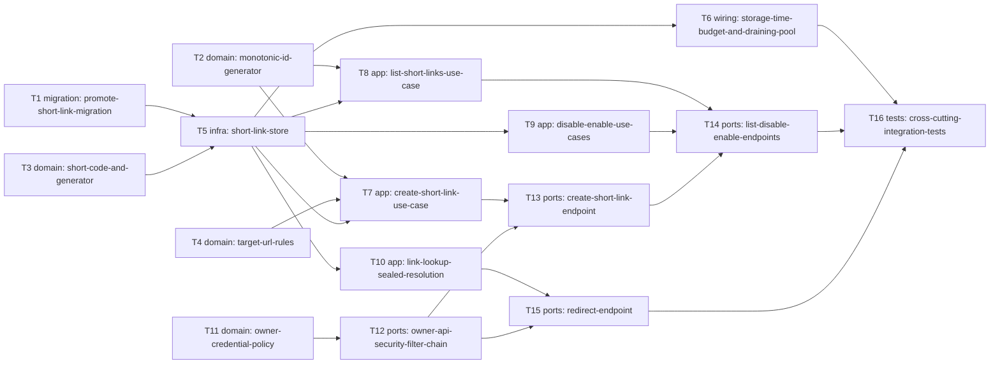

# Epic — url-shortener

> **Spec:** [spec.md](../spec.md) · **Design:** [sad.md](../sad.md) · **Data model:** [data-model.md](../data-model.md) · **API:** [openapi.yaml](../contracts/openapi.yaml) · **ADRs:** [adr/](../adr/)

## Goal

Ship trimly's first feature (roadmap step 2): the owner, holding the owner credential, creates, lists,
disables and re-enables short links, and any visitor who opens a short link is redirected to its target
URL — or told plainly «link not found» or «temporarily unavailable» (spec §2 Goals 1–3). Built through the
spec → design → tasks → TDD trail, it becomes the pattern later roadmap steps follow (spec §2 Goal 4).

## Scope

- **In:** new `access` module (owner credential, Spring Security filter chain); `link` module (domain rules,
  Spring Data JDBC store, use cases, owner API, published `LinkLookup`); `redirect` module (public redirect);
  `shared` (monotonic `IdGenerator`, `shared.malformed_request` code); migration `V2__create_short_link.sql`;
  storage time budget + draining pool + DB-free health/metrics config.
- **Out:** invited users (step 4), custom aliases (step 5), click analytics (step 6), anonymous creation,
  changing a target URL or deleting a link, target reachability/safety checks, any web UI, visitor rate
  limiting, the deploy pipeline (step 3) (spec §3, sad §8 Rate limiting, sad §7).

## Task map

**Waves** (tasks in a wave can run in parallel, subject to lanes):

| Wave | Tasks |
|---|---|
| 1 | T1, T2, T3, T4, T11 |
| 2 | T5, T12 |
| 3 | T6, T7, T8, T9, T10 |
| 4 | T13, T15 |
| 5 | T14 |
| 6 | T16 |

**Serialized lanes** (overlapping `files_hint`):
- T12 · T5 · T6 · T7
- T12 · T6
- T13 · T14
- T5 · T6
- T6 · T7

## Tasks

See [tracker.md](./tracker.md) for status. Machine contract: [tasks.json](../tasks.json).

| # | Task | Layer | Blocked by | DoD (short) |
|---|---|---|---|---|
| T1 | [Promote the staged short_link migration to V2__create_short_link.sql](./promote-short-link-migration.md) | migration | — | `V2__create_short_link.sql` applies on a fresh Testcontainers Postgres at startup (`ApplicationBootIT` still green). |
| T2 | [Make shared.IdGenerator monotonic within a millisecond (RFC 9562 method 1)](./monotonic-id-generator.md) | domain | — | `IdGeneratorTest` covers same-ms ordering, overflow and backwards clock, and passes. |
| T3 | [Add ShortCode (alphabet, length, well-formedness) and the SecureRandom ShortCodeGenerator](./short-code-and-generator.md) | domain | — | `ShortCodeTest` passes: alphabet = 56 chars, every look-alike excluded, well-formedness table from Edge cases. |
| T4 | [Add TargetUrl validation rules (scheme, length, encoding, own hosts) in link.domain](./target-url-rules.md) | domain | — | `TargetUrlTest` covers every Edge-case row and passes. |
| T5 | [Persist ShortLink through a Spring Data JDBC store with constraint-aware failure translation](./short-link-store.md) | infra | T1, T3 | `ShortLinkStoreIT` passes for insert, find-by-code, keyset page (incl. `size + 1` look-ahead) and state update (changed / unchanged / unknown). |
| T6 | [Bound every storage call to 2 s, drain the idle pool and keep health checks off the DB](./storage-time-budget-and-draining-pool.md) | wiring | T5 | `StorageTimeBudgetIT` passes: every store operation answers `LinkStorageUnavailable` ≤ 2 s with the container paused, and succeeds after unpause. |
| T7 | [Implement the CreateShortLink use case with 5-attempt insert-retry and public-base-url](./create-short-link-use-case.md) | app | T2, T4, T5 | `CreateShortLinkTest` passes for AC-02 and every AC-20b branch with a stub generator. |
| T8 | [Implement ListShortLinks with keyset paging and an opaque continuation cursor](./list-short-links-use-case.md) | app | T2, T5 | `ListShortLinksIT` passes: newest-first incl. same-ms ties, default 20 / max 100, concurrent-insert paging without duplicates or gaps, empty list. |
| T9 | [Implement DisableShortLink and EnableShortLink as one idempotent state change](./disable-enable-use-cases.md) | app | T5 | `ChangeLinkStateIT` passes for every Edge-case row (store spy asserts no call for a malformed code). |
| T10 | [Publish link.app.LinkLookup returning a sealed Resolution (Found / NotFound / Unavailable)](./link-lookup-sealed-resolution.md) | app | T5 | `LinkLookupTest` passes: three outcomes + no store call on malformed input. |
| T11 | [Add the access module's OwnerCredentialPolicy and fail-fast OwnerCredentialProperties](./owner-credential-policy.md) | domain | — | `OwnerCredentialPolicyTest` covers every Edge-case row. |
| T12 | [Guard the owner API with a stateless bearer SecurityFilterChain and a Problem Details entry point](./owner-api-security-filter-chain.md) | ports | T11 | `OwnerApiSecurityIT` passes: missing vs wrong credential byte-identical 401 with `code: access.authentication_required`; visitor path needs no credential. |
| T13 | [Expose POST /api/v1/links and the Problem Details `code` mapping for owner errors](./create-short-link-endpoint.md) | ports | T7, T12 | `CreateShortLinkIT` passes for AC-01 (201 shape, `shortUrl` host independence), AC-03…AC-06 (one 400 code each, nothing stored) and AC-17b (503). |
| T14 | [Expose GET /api/v1/links and POST …/{shortCode}/disable|enable](./list-disable-enable-endpoints.md) | ports | T8, T9, T13 | `ListShortLinksIT` passes AC-09 (order, default/max size, continuation), AC-10 and the two 400 codes. |
| T15 | [Serve GET /{shortCode}: non-reusable 302, plain-text 404/503, query ignored](./redirect-endpoint.md) | ports | T10, T12 | `RedirectIT` passes AC-07 (302, `Location`, `no-store`, slash/query), AC-12, AC-16, AC-16b (no lookup — spy), AC-19 (no credential). |
| T16 | [Add end-to-end ITs: link lifecycle, storage outage within 2 s, and auth denial parity](./cross-cutting-integration-tests.md) | tests | T6, T14, T15 | All three ITs pass in `./mvnw -B verify` (Docker). |

## Risks / Hard rules

- **Layers & modules:** `domain` has no Spring or persistence imports; modules use only each other's published
  `api`/`app` types; `ModularityTest` fails the build otherwise (sad §2, repo ADR-0002). `redirect` reaches
  storage only through `link.app.LinkLookup` (ADR-0005).
- **No redirect caching**, every redirect reads storage; redirects are temporary with `Cache-Control: no-store`
  (sad §2, §8) — T15 asserts it survives Spring Security's default headers.
- **2 s storage budget** on every call, outage ≠ «link not found» (ADR-0003, AC-17/17b). The timeout split is
  tuned in T6 against the paused-container IT; whole-second driver/JDBC timeouts make a ms-level
  `statement_timeout` the likely lever (sad §11 timeout-split risk).
- **Single-statement writes**, insert-retry never inside one transaction (sad §8 Storage access, ADR-0002).
- **Owner credential** never logged or echoed; missing = wrong, byte-identical 401 (spec §6.1, AC-18).
  Env var name `TRIMLY_OWNER_CREDENTIAL` is proposed in T11 — not fixed upstream.
- **Errors:** owner path = Problem Details + `code` via the single shared advice; visitor path = plain text,
  never Problem Details (sad §8, ADR-0005).
- **Spec sync still open (sad §11):** spec §6 measures availability with a 5-min probe, while ADR-0006 sets
  15 min — update spec §6 before `plan-tests`. Not a code task.
- **Doc drift:** T12 adds `access` to `CLAUDE.md` and `docs/architecture-map.md` (sad §11).
- **Security review** of the auth boundary and redirect surface is required before `ship` (spec §6.1).
