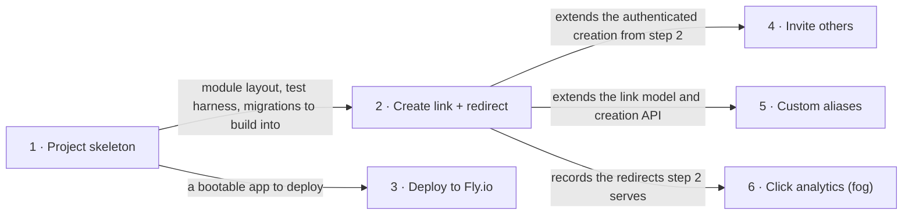

# Roadmap — trimly

> **A decomposition, not a promise.** The overall idea broken into incremental steps: what each
> step is, where it comes from, how big it is — or that nobody has looked at it yet — and in which
> order, and parallel lanes, we walk them. **No dates** (except shipped history), **no scores** —
> order is the prioritization. The *solution* for any step lives in its `docs/features/<slug>/`
> spec, not here.

## Destination

trimly runs always-on at a public URL for about $5 a month as a Java service, built entirely through the agent-driven SDD pipeline; the owner and invited users create short links, generated or custom, that redirect anyone instantly, and basic click analytics show how the links are used.

## Steps

| # | Step | Source | Size | Status |
|---|---|---|:---:|---|
| 1 | Project skeleton: the Maven/Spring Boot project, test harness, Flyway and CI are in place, so `./mvnw -B verify` passes (`docs/features/_scaffold/tasks.json`) | `docs/architecture-map.md` §Conventions | S | idea |
| 2 | Create a short link and get redirected: the owner creates a link with a generated code through an authenticated API, and anyone opening it is redirected ([`features/url-shortener/`](features/url-shortener/spec.md)) | `docs/idea-brief.md` §7. Recommendation | M | building |
| 3 | Deploy to Fly.io: the service runs always-on at a public URL against Neon Postgres, deployed from CI | `docs/idea-brief.md` §5. Out of scope (Constraints) | S | idea |
| 4 | Invite others to create links: invited users, not only the owner, can create short links | `docs/idea-brief.md` §5. Out of scope | S | idea |
| 5 | Custom aliases: a link creator picks the short code instead of getting a generated one | `docs/idea-brief.md` §7. Recommendation | S | idea |
| 6 | Basic click analytics → see [Not yet specified](#not-yet-specified) | `docs/idea-brief.md` §1. Raw idea | fog | idea |

## Not yet specified

| Area | What we'd have to learn | Blocks | How it gets sharpened |
|---|---|:---:|---|
| Basic click analytics | What "basic" means to the owner (total counts only, counts over time, referrers, devices?), who sees it and how, and how a click gets recorded without slowing the redirect or blowing the Neon Free compute budget | 6 | A recon conversation with the owner about which questions the analytics must answer, then `/sdd:specify` for step 6 |

## Out of scope

- AI or LLM features inside the product: the "agent development" goal is about how trimly is built, not what it does.
- Anonymous public link creation and the abuse handling it needs: only the owner and invited users create links.
- Competing with commercial shorteners: this is a learning / portfolio project.

## Open decisions

| # | Question | Type | Owner | Blocks |
|---|---|:---:|:---:|:---:|
| D1 | How do invited users get access to link creation: per-user API keys handed out by the owner, or accounts with login, or something else? | grilling | human | 4 |
| D2 | Should short links use a purchased short custom domain, or the host's default subdomain? | grilling | human | — |
| D3 | Does the Spring Boot service run reliably on a 512 MB Fly.io Machine, and which JVM memory settings does it need? | prototype | agent | 3 |

## Decisions so far

- Learning / portfolio project; only the owner and invited users create links; redirects public; no AI in product → [`docs/idea-brief.md` §5, §7](idea-brief.md)
- Hosting budget about $5/month, always-on rather than free tier → [`docs/idea-brief.md` §5](idea-brief.md)
- Java 21, Spring Boot 4.1, Maven → [ADR-0001](adr/0001-use-java-21-spring-boot-and-maven.md)
- Feature modules with layers, with boundaries enforced by tests → [ADR-0002](adr/0002-organize-code-as-feature-modules-with-layers.md)
- PostgreSQL on Neon Free via Spring Data JDBC, Flyway migrations, UUIDv7 keys → [ADR-0003](adr/0003-store-links-in-postgres-on-neon-via-spring-data-jdbc-and-flyway.md)

## Dependency graph

## Execution path

| Wave | Steps | Zone per step (why parallel-safe) | Unlocks |
|:---:|---|---|---|
| 1 | 1 | whole repo skeleton: `pom.xml` (new), `src/` (new), `.github/workflows/ci.yml` (new) | 2, 3 |
| 2 | 2 ∥ 3 | 2: `src/main/java/io/github/igorermolenko/trimly/link/` + `redirect/` + `src/main/resources/db/migration/` (new) · 3: `Dockerfile`, `fly.toml`, `.github/workflows/deploy.yml` (new) (disjoint: application code vs deployment config) | 4, 5 |
| 3 | 4 ∥ 5 | 4: `src/main/java/io/github/igorermolenko/trimly/access/` + security config (new) · 5: `src/main/java/io/github/igorermolenko/trimly/link/` (new) (disjoint only if step 2 keeps authentication out of `link`; serialize if its design puts it there) | — |

Step 6 enters a wave after its recon pass gives it a size.

## Shipped

| Step | Shipped | Link |
|---|---|---|
